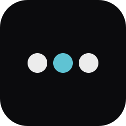
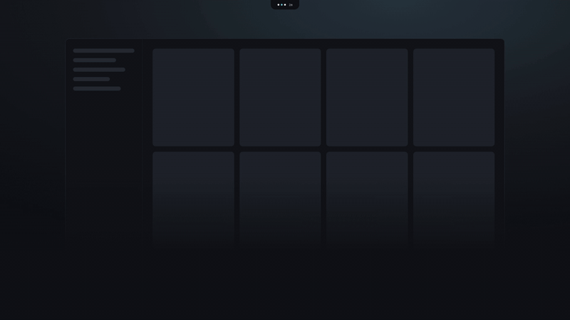
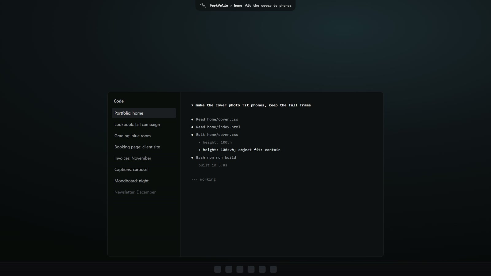
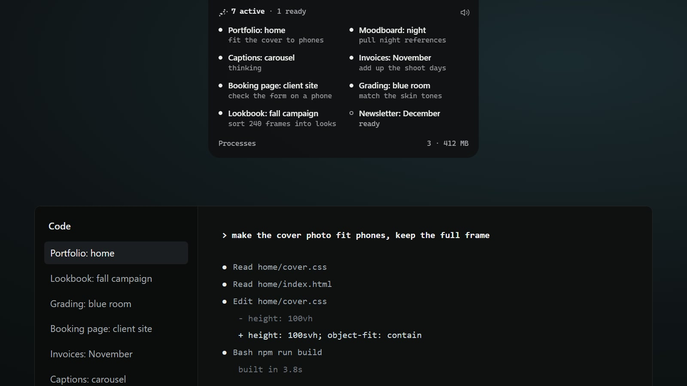
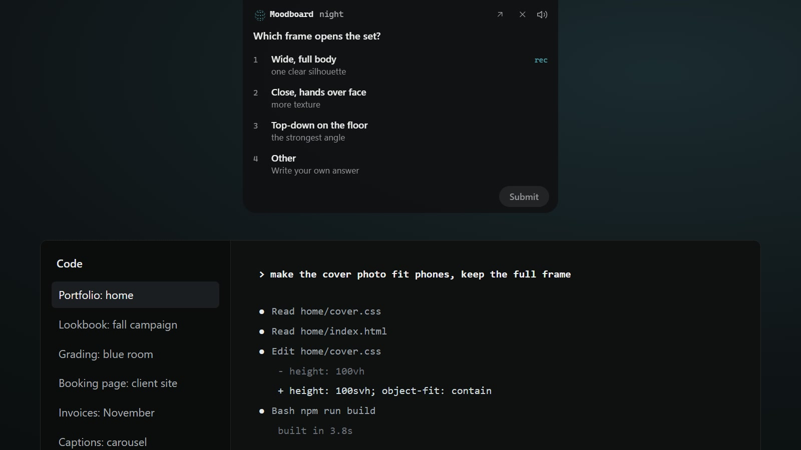
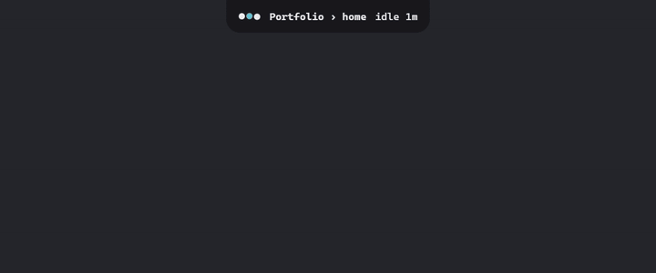
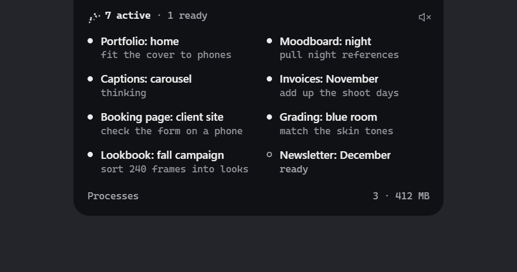
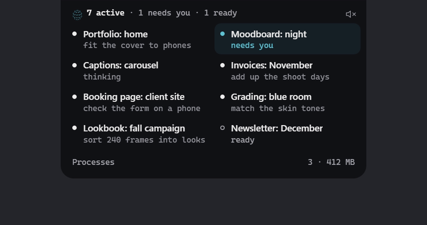
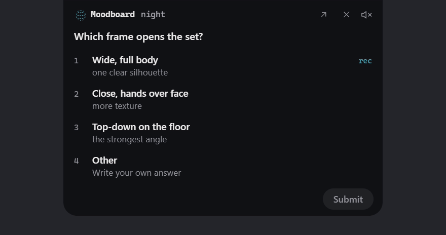
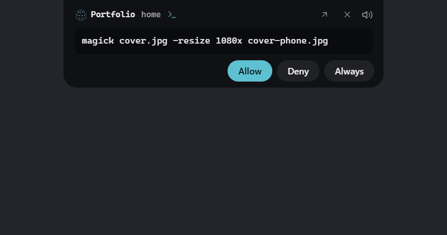

<p align="center"></p>

<h1 align="center">LOUPE</h1>

<p align="center">Your Claude Code sessions, live, in one black island at the top of the screen.<br>Windows and Mac. Local only.</p>

<p align="center">
<a href="https://github.com/loupedesk/loupe/releases/latest"></a>
<a href="https://github.com/loupedesk/loupe/releases"></a>
<a href="LICENSE"></a>
<a href="https://x.com/loupedesk"></a>
</p>

<p align="center"></p>

**Install:** paste the [prompt for your computer](#install-or-upgrade-with-claude) into Claude Code, or download the [latest Windows installer](https://github.com/loupedesk/loupe/releases/latest). The installer is unsigned, so SmartScreen shows "More info", then "Run anyway".

Free and MIT licensed. If LOUPE helps you, a star helps other people find it.


A black island at the top of the main display that shows your live Claude Code sessions: what each one is doing, and a mirror of every permission and question. Click a project to open it in the Claude app. On a Mac it sits in the notch.

Questions and permissions show in the Claude Code thread and LOUPE mirrors them. Turn on answering on LOUPE in the tray to pick and Submit without leaving what you're in.

## In action

<p align="center"></p>
<p align="center"></p>
<p align="center"></p>

## How it works

<p align="center"></p>

```
Claude Code hook  >  relay.js  >  local pipe  >  LOUPE island
```

Every hook event runs `relay.js`. The relay hands it to LOUPE over a named pipe (a Unix socket on the Mac) and exits. LOUPE keeps one row per thread and draws the most urgent one in the orb.

| Idle | Thinking | Working |
|:-:|:-:|:-:|
|  |  |  |
| The orb folds into the mark. | A prompt went in. | The step it is on, in plain words. |

| Open | Needs you |
|:-:|:-:|
|  |  |
| Hover the island. One row per live thread. | Cyan, a sound, and the panel opens by itself. |
| **Question** | **Permission** |
|  |  |
| Mirrored from the thread, or picked and submitted here if you turn that on. | Mirrored from the thread, or answered here if you turn that on. |

## Install or upgrade with Claude

Paste the prompt for your computer into Claude Code (the Claude app's Code tab or the terminal). It handles a fresh install and an upgrade of an older LOUPE, and leaves LOUPE updating itself from this repo's releases.

### Windows

```
Install or upgrade LOUPE on this Windows PC. LOUPE is a small always-on-top island that mirrors my Claude Code sessions. Repo and releases: https://github.com/loupedesk/loupe. Use PowerShell. Ask me before anything hard to undo, never delete my files, and use no em dashes in anything you write.

1. Node: run `node -v` (needs 18 or newer, the hooks run node). If it is missing, ask me before running `winget install OpenJS.NodeJS.LTS`.
2. What is there now: if `$env:LOCALAPPDATA\Programs\LOUPE\LOUPE.exe` exists, note its version with `(Get-Item <path>).VersionInfo.ProductVersion`. Note every hook command in `~/.claude/settings.json` that mentions relay.js, loupe or coucou. If the installed version already matches the latest release, skip to step 5.
3. Download the latest installer into a new empty folder: `$d = New-Item -ItemType Directory -Force "$env:TEMP\loupe-install"`. Get the asset URL from `Invoke-RestMethod https://api.github.com/repos/loupedesk/loupe/releases/latest` (the asset named `LOUPE-Setup-<version>.exe`), download it with `Invoke-WebRequest -OutFile`, then `Unblock-File` it.
4. Install. This upgrades an older LOUPE in place and keeps its settings: `Stop-Process -Name LOUPE -ErrorAction SilentlyContinue`, then `Start-Process -Wait <installer> -ArgumentList '/S'`. It installs per user (no admin) to `%LOCALAPPDATA%\Programs\LOUPE` and starts LOUPE. If LOUPE is not running 5 seconds later, start `LOUPE.exe`.
5. Hooks: run `& "$env:LOCALAPPDATA\Programs\LOUPE\LOUPE.exe" --check-hooks`. If the dialog says the hooks need a look, tell me to click "Fix hooks" in it myself, or Link Claude in the tray (Claude Code's safety check won't let you edit its own settings), and wait for me. LOUPE backs up `~/.claude/settings.json` to `settings.json.bak-loupe-<time>`, removes old LOUPE hooks (any old relay.js path) and Coucou hooks, and adds the 10 LOUPE hooks pointing at `~/.loupe/relay.js`, which LOUPE rewrites on every launch. Other hooks stay. The next dialog says "Claude Code hooks are set". Show me the hook part of the diff against the backup. Leave any old relay.js file on disk where it is.
6. Test: `'{"hook_event_name":"UserPromptSubmit","session_id":"loupe-test","cwd":"C:/LOUPE TEST"}' | node "$HOME/.loupe/relay.js"` makes "LOUPE TEST" show "thinking" at the top centre of the main display. It clears itself after 10 seconds.
7. Report the version before and after, what changed in the hooks, and that new Claude Code sessions now show on LOUPE (running sessions show up on their next event). The tray icon (three dots) has "Check for updates", "Check Claude Code hooks" and the settings.
```

### Mac

```
Install or upgrade LOUPE on this Mac. LOUPE is a small island in the notch that mirrors my Claude Code sessions. Repo: https://github.com/loupedesk/loupe. Ask me before anything hard to undo, never delete my files, and use no em dashes in anything you write.

1. Check `node -v` (18 or newer) and `git --version`. If Node is missing, ask me before `brew install node`.
2. What is there now: if /Applications/LOUPE.app exists, note its version (`defaults read /Applications/LOUPE.app/Contents/Info CFBundleShortVersionString`). Note every hook command in ~/.claude/settings.json that mentions relay.js, loupe or coucou.
3. Source: clone https://github.com/loupedesk/loupe to ~/LOUPE-src, or `git -C ~/LOUPE-src pull` if it is already there. Then run `npm install` and `npx electron-builder --mac` in it. The build is unsigned on purpose, so a signing skip warning is fine.
4. Install: `pkill -x LOUPE`, then copy the app for this Mac (`uname -m`: arm64 is dist/mac-arm64/LOUPE.app, x86_64 is dist/mac/LOUPE.app) over /Applications/LOUPE.app with `ditto`. Settings live in ~/Library/Application Support/LOUPE and stay. Ad-hoc sign it: `codesign --force --deep --sign - /Applications/LOUPE.app`, clear quarantine: `xattr -dr com.apple.quarantine /Applications/LOUPE.app`, then `open /Applications/LOUPE.app`. No Dock icon is expected.
5. Hooks: `/Applications/LOUPE.app/Contents/MacOS/LOUPE --check-hooks`. If the dialog says the hooks need a look, tell me to click "Fix hooks" in it myself (or Link Claude in the menu bar icon) (Claude Code's safety check won't let you edit its own settings), and wait for me. It backs up ~/.claude/settings.json, swaps old LOUPE and Coucou hooks for the 10 LOUPE hooks at ~/.loupe/relay.js, and leaves other hooks alone. Show me the hook part of the diff against the backup. Fix writes node's full path from my login shell into the hook commands. If the dialog says node is not found, ask me before `brew install node`, then run the check again.
6. Test: `echo '{"hook_event_name":"UserPromptSubmit","session_id":"loupe-test","cwd":"/tmp/LOUPE TEST"}' | node ~/.loupe/relay.js` grows the notch with "LOUPE TEST thinking". Take a screenshot of the top of the screen and show me. It clears itself after 10 seconds.
7. Report the version before and after and what changed in the hooks. Updates: the Mac build is unsigned, so macOS won't let it update itself. When a new release is out, LOUPE shows "LOUPE x is out", and running this prompt again upgrades it.
```

### By hand (Windows)

1. Download `LOUPE-Setup-<version>.exe` from [the latest release](https://github.com/loupedesk/loupe/releases/latest) and run it. It is unsigned: SmartScreen shows "More info", then "Run anyway".
2. On first run LOUPE asks "Link Claude Code to LOUPE?". Click Link Claude. Later: the island shows "Claude not linked" until it is linked, and the tray has Link Claude.

## Updates

Windows installs from 0.2.12 on update themselves: LOUPE checks this repo's releases on launch and every 4 hours, downloads in the background and asks before it installs: "LOUPE x is ready" with the release notes, Restart to update or Later (asked again after a day). From 0.3.2 on nothing installs without that yes; older builds install on quit. A download installs only if its `.sig` checks out against the release key built into LOUPE; otherwise it is refused and logged. Tray "Check for updates" checks now and shows the installed version. Once a download is ready it reads "Restart to update". The updater writes `updater.log` next to `config.json`. Installs older than 0.2.12 need the prompt above once.

## Hooks

Claude Code talks to LOUPE through `relay.js`, which forwards each hook event over a named pipe (a Unix socket on the Mac). LOUPE writes its own copy to `~/.loupe/relay.js` on every launch, so updates reach it. If LOUPE is closed, the relay exits at once and Claude Code works as usual.

The first line of the tray menu says whether Claude Code is linked:

- **Linked · 2:14 AM, JG WEBSITE NEW**: the time and session of the last hook event.
- **Linked · waiting for a session**: the hooks are set, nothing has arrived since LOUPE started. Running sessions keep the hooks they started with, so restart them.
- **Claude not linked**, **Claude link needs repair**, **Node.js not found**: the island stays visible with the same words in cyan, and opening it offers Link Claude, Repair link or Get Node.js. The tray has the same button. First run asks once.

Link Claude and Repair link back up `~/.claude/settings.json`, swap only LOUPE and Coucou hooks for the 10 LOUPE hooks, then send one test event through node and `~/.loupe/relay.js`. "Claude Code is linked" means that event reached LOUPE. On a Mac the hooks use node's full path from your login shell (`command -v node`), since the Claude app opened from the Dock may not have node on its PATH; plain `node` passes the check too.

Tray "Link details" (or `LOUPE --check-hooks`) shows whether `node` runs, whether each hook points at `~/.loupe/relay.js`, leftover Coucou or old-path hooks, and when the last event came in. "Fix hooks" (or `LOUPE --fix-hooks`, no dialog first) writes these after a backup:

```json
"hooks": {
  "SessionStart":       [{ "hooks": [{ "type": "command", "command": "node \"<home>/.loupe/relay.js\"", "timeout": 5 }] }],
  "SessionEnd":         [{ "hooks": [{ "type": "command", "command": "node \"<home>/.loupe/relay.js\"", "timeout": 5 }] }],
  "UserPromptSubmit":   [{ "hooks": [{ "type": "command", "command": "node \"<home>/.loupe/relay.js\"", "timeout": 5 }] }],
  "PreToolUse":         [{ "hooks": [{ "type": "command", "command": "node \"<home>/.loupe/relay.js\"", "timeout": 3600 }] }],
  "PermissionRequest":  [{ "hooks": [{ "type": "command", "command": "node \"<home>/.loupe/relay.js\"", "timeout": 3600 }] }],
  "PostToolUse":        [{ "hooks": [{ "type": "command", "command": "node \"<home>/.loupe/relay.js\"", "timeout": 5 }] }],
  "PostToolUseFailure": [{ "hooks": [{ "type": "command", "command": "node \"<home>/.loupe/relay.js\"", "timeout": 5 }] }],
  "Notification":       [{ "hooks": [{ "type": "command", "command": "node \"<home>/.loupe/relay.js\"", "timeout": 5 }] }],
  "Stop":               [{ "hooks": [{ "type": "command", "command": "node \"<home>/.loupe/relay.js\"", "timeout": 5 }] }],
  "StopFailure":        [{ "hooks": [{ "type": "command", "command": "node \"<home>/.loupe/relay.js\"", "timeout": 5 }] }]
}
```

## Prompts

Questions show in the thread and LOUPE mirrors them; "Answer in Claude" opens the session. Tray "Answer questions on LOUPE" makes them wait on LOUPE instead: pick, then Submit answers there, and the thread doesn't show it meanwhile. Each question has one owner at a time. It goes back to the thread, with LOUPE keeping a mirror, when Claude's window comes to the front, after 2 minutes with no keyboard or mouse, or on "in app" or ×. One that comes in while Claude is in front or you're away goes straight to the thread.

Permissions and plan approvals show in the thread at once and LOUPE mirrors them. Tray "Answer permissions on LOUPE (hides them from the thread until answered)" makes permissions wait for the island too: Allow / Deny / Always. That's why `PreToolUse` and `PermissionRequest` have the long timeout.

## Processes (Windows)

Claude sessions can leave dev servers, log tails and watchers running after you are done with them. Processes lists them, and helps you close the ones you no longer need. It is off until you turn it on: LOUPE asks once after the update, and the tray's Settings > "Processes" switch or "Turn off" in the panel changes it any time.

- **Under each thread:** the hover list shows "2 bg" beside a thread with background tasks, and a Processes row at the bottom. Each thread is one line; click it for its tasks with port, memory, age and a Kill button.
- **No session:** tasks whose thread is gone (closed, archived or crashed). A task under 15 minutes old, or one whose command names the folder of a session that is working, shows "in use" with no Kill.
- **Suggested:** everything under No session that is not in use, plus tasks of threads idle 2 hours or more. Review to untick any, then Kill. Every kill asks first.
- **Keep:** command lines matching a line in `~/.claude/skills/reap/allow.txt` (or the bundled `reap/allow.txt`) are never suggested.
- The engine is `reap/reap.ps1` (rules from [zclean](https://github.com/TheStack-ai/zclean), MIT). It re-checks each PID's start time and command before `taskkill /T`, kills at most 20 at a time, and logs to `~/.claude/reap.log`. Run it alone: `reap.ps1` lists, `-Kill <pids>`, `-Json`, `-SelfTest`.
- While on, LOUPE runs it every 2 minutes and when the panel opens. Off, it never runs.

## Hush (Windows)
[Hush](https://github.com/loupedesk/hush) mutes you on Discord while you dictate to the Claude app. Tick **Add Hush** in LOUPE's tray and LOUPE runs it for you: no second tray icon. Off by default. On, it is one tray row showing Hush's status, with Pause, Quiet mute, updates and Turn off Hush inside.
- LOUPE downloads `Hush.exe` from Hush's releases into its own settings folder and runs it only if its `.sig` checks out against the release key. It updates it the same way, once a day, never while Hush holds a mute.
- Hush's status, Pause and Quiet mute show in the tray. It starts and stops with LOUPE, so LOUPE's Start with Windows covers it.
- If the Hush app is already running, LOUPE says so and leaves it in charge. Discord is never muted twice.
- Hush needs a Discord app of your own (Discord allows voice control for nothing else). **Set up Discord keys…** opens a small window for its Client ID and secret and saves them as your user env vars, the same ones Hush's installer writes. Then accept Discord's Authorize popup once.

## Check it

- The island sits at the top centre of the main display. Hover it to open the list.
- Send a prompt in any session: its project shows "thinking", then what it's doing.
- Speaker at the top right of the open panel: click for the volume slider, right click to mute.
- Tray icon (three dots, left or right click): close delay, gooey motion, sounds, prompts on LOUPE, Start with Windows, link status, Link details, updates, Quit.

## How it reads sessions

- **Project:** the session's folder. Worktrees count under their parent project.
- **Step:** the session's title in the Claude app. "Site - QA" shows as QA. Each thread has its own row in the list, with what it's doing on the line under.
- The 5 most active projects show. Needs-you comes first, in cyan, with a sound.

## Privacy

- Everything stays on the PC. Hook events go from `relay.js` to LOUPE over a local pipe and nowhere else.
- The relay fails open. If LOUPE is closed, it exits at once and Claude Code works as usual.
- `~/.claude/settings.json` is backed up to `settings.json.bak-loupe-<time>` before LOUPE changes a hook. Other hooks stay.
- Update checks and downloads from this repo's GitHub releases are the only network use.
- What LOUPE keeps, all on the PC, all plain files you can open or copy: tray settings in `config.json`, `updater.log` and `loupe.log` (errors) in its app data folder (`%APPDATA%\loupe`, Mac `~/Library/Application Support/LOUPE`), each trimmed past 256 KB. Up to 3 `settings.json.bak-loupe-*` backups: the first one (your settings from before LOUPE) and the newest 2. `~/.claude/reap.log` (Processes kills, tokens masked), trimmed past 256 KB. Sessions live in memory only and drop after 12 hours idle.

## Dev

- `npm ci`, then `npm start` runs from source. Quit the installed app first: only one copy runs at a time.
- `npm test` runs every test (CI runs it on Windows and macOS for each push and PR). `test/baseline.test.js` has one test per BASELINE.md check; `node scripts/checks.js <ID>` runs the repo checks (secret scan, lockfile, CI, contrast, versions).
- `node scripts/exit-check.js` and `node scripts/measure.js` start a copy in a scratch profile (Windows) and check what it leaves after quit, and its start time, memory and CPU.
- Agents working here: reuse a running `npm start`, and stop every copy, dev server and measuring script you started before ending the turn. Nothing stays running in a worktree.
- `npm run icons` re-exports the icons from `logo/`.
- `npm run dist` builds the Windows installer into `dist\`, `npm run dist:mac` the Mac zips (on a Mac).
- `node sessions.js` and `node hooks.js` run the self-checks.
- Dev env vars: `LOUPE_SNAP=<png>` writes what the window draws every second, `LOUPE_CLICK=<file>` runs one line per second on the page (`js:` lines run as code), `LOUPE_NOTCH=WxH` fakes a notch, `LOUPE_USERDATA=<dir>` uses a scratch profile, `LOUPE_REAP=<ps1>` swaps the Processes scan (checks only).

## Release an update

1. Bump `version` in `package.json` (e.g. 0.2.12 to 0.2.13), the only place the version lives. Installs only update to a higher version. Add a plain-words entry for it to `CHANGELOG.md`.
2. `npm test`, then commit and push the source: `git commit -am "LOUPE <version>" && git push`. Push first: the release tag and the Mac build come from what is on `main` when the release goes public.
3. Publish. `GH_TOKEN` comes from the environment, never typed or pasted. With the GitHub CLI logged in:
   ```bash
   GH_TOKEN="$(gh auth token)" npm run release
   ```
   This first makes the draft release `v<version>` (`scripts/draft-release.js`: electron-builder runs two GitHub publishers, and without a draft already there each made its own, splitting the files across two releases; it stops if the version is already public or has two releases). Then it builds, uploads the installer, its `.blockmap` and `latest.yml` to that draft release (`releaseType: draft` in package.json), signs the installer and uploads `LOUPE-Setup-<version>.exe.sig`, and only then makes the release public (`scripts/publish-release.js`). Installs refuse an update without the `.sig`, so nothing is public until it is there. If a step fails, the draft stays hidden: fix it, then run `node scripts/sign-release.js --upload` and `node scripts/publish-release.js`. Signing uses Windows Hello: the release shows a fingerprint or PIN prompt. Installs trust two keys, `HELLO` and `RECOVERY` in `update-signature.js` (Secrets). The Hello prompt does not say what is being signed, so approve it only while running your own release. To sign with the recovery key instead (the transition release, or after the Hello key is lost), run `$env:RELEASE_RECOVERY = '1'` first; it asks for the passphrase. Then run the steps of the `release` script in package.json with node or npx directly, not `npm run release`: under `npm run` the passphrase prompt gets garbled on Windows and always says "wrong passphrase". Build once and sign that build: a rebuild needs a new signature.
4. Check https://github.com/loupedesk/loupe/releases/latest lists `latest.yml`. Running installs pick it up within 4 hours, or now with tray "Check for updates", and ask before they restart to install. GitHub's release feed can lag a minute or two after publishing.

Mac: GitHub builds the zips and adds them to the release when it goes public (`.github/workflows/mac-release.yml`). Mac installs only get a "LOUPE x is out" dialog, since unsigned apps can't update in place.

The packaged app's `package.json` has no `build` key (electron-builder strips it), so the app never reads its own publish config.
